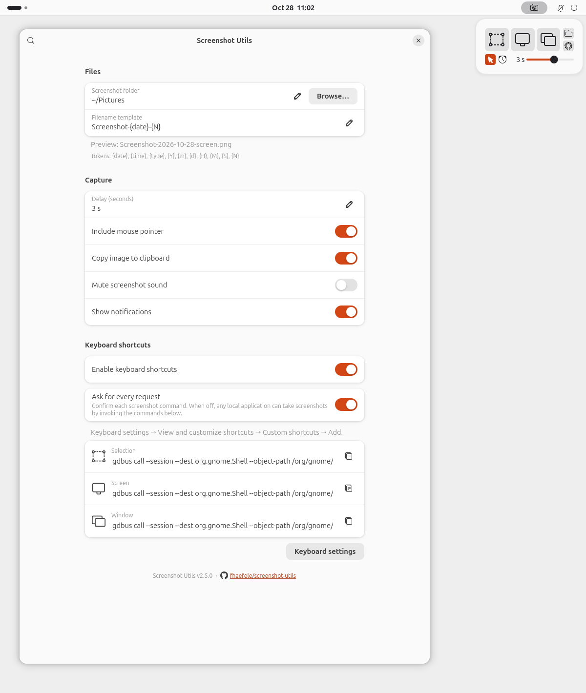

# Screenshot Utils

Capture a selection, screen or window as a PNG in GNOME Shell 42-51 on Wayland.

<picture>
  <source media="(prefers-color-scheme: dark)" srcset="assets/screenshot-utils-dark.png">
  <source media="(prefers-color-scheme: light)" srcset="assets/screenshot-utils.png">
  
</picture>

- Set a capture delay from 0 to 30 seconds in the menu.
- Toggle mouse cursor capture with the cursor icon beside the clock. The theme accent means on; dimmed means off.
- Choose the screenshot folder, filename template, clipboard, sound and notifications in Preferences. Screenshots save to Pictures by default. Muting the sound also mutes GNOME's own screenshots.

Release a selection or choose a window to capture. Escape or right-click cancels.

## Install

Install or update to the latest release for your GNOME version with one command. Requires Bash, curl and GNOME's extension tools. Installs for the current user without sudo.

```sh
curl -fsSL https://raw.githubusercontent.com/fhaefele/screenshot-utils/main/scripts/install.sh | bash
```

Or download the matching ZIP from [Releases](https://github.com/fhaefele/screenshot-utils/releases/latest).

GNOME Shell 42-44:

```sh
gnome-extensions install --force screenshot-utils-gnome42-44.shell-extension.zip
```

GNOME Shell 45-51:

```sh
gnome-extensions install --force screenshot-utils-modern.shell-extension.zip
```

After installing or updating, log out and back in, then enable Screenshot Utils in Extensions.

Preferences shows the installed version and checks GitHub for compatible releases at most once every 24 hours when opened. A latest-version link opens the newer release page; use the command above to update.

## Keyboard shortcuts

Shortcuts start off. In Preferences, turn on **Enable keyboard shortcuts** and choose a **Source**. New setups select Extension.

Choose **Extension** to assign keys in Preferences. They work globally outside Overview and Shell menus or dialogs, without confirmation. Occupied system shortcuts are rejected. External screenshot commands are disabled in this mode.

Choose **GNOME keyboard settings** to configure custom shortcuts under Keyboard settings → View and customize shortcuts → Custom shortcuts → Add. Copy the commands from Preferences.

**Ask for every request** applies to GNOME commands and starts on. When off, any local application can invoke the commands without confirmation. The choice persists across logins and restarts. Switching to Extension resets Ask to on. Unrestricted programs running as you can change these settings, including turning confirmation off.

Turning shortcuts off cancels pending shortcut captures and keeps assignments. Print Screen stays unchanged.

## Build and test

```sh
npm ci
npm run pack
npm test
npm run lint
npm run test:gnome  # GNOME Shell 45-51
npm run test:legacy # GNOME Shell 42-44
```

Packages are in `dist/legacy/` and `dist/modern/`. Shell tests use isolated settings. CI runs GNOME Shell 42, 46 and 50. Multiple monitors and fractional scaling still need manual testing.

## License

[GPL-3.0-or-later](LICENSE). Inspired by [Screenshot Tool](https://github.com/OttoAllmendinger/gnome-shell-screenshot) and [No Screenshot Box](https://github.com/abdallah-alkanani/no-screenshot-box).
